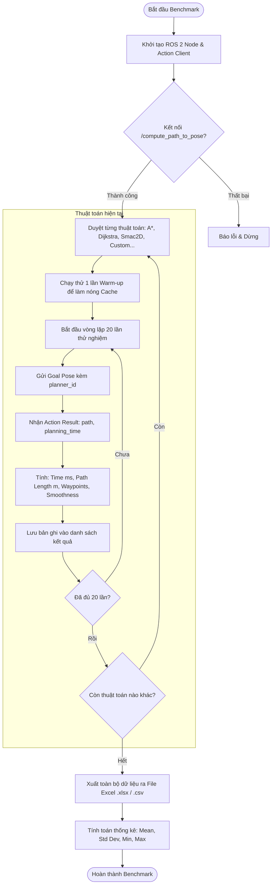

# HƯỚNG DẪN NGHIÊN CỨU & SO SÁNH THỰC NGHIỆM CÁC THUẬT TOÁN QUY HOẠCH ĐƯỜNG ĐI TOÀN CỤC (GLOBAL PATH PLANNERS) TRONG ROS 2 NAV2

Tài liệu này trình bày toàn bộ **nguyên lý khoa học**, **kiến trúc phần mềm**, và **phương pháp luận thực nghiệm** để so sánh đánh giá hiệu năng giữa nhiều thuật toán Global Path Planning khác nhau (ví dụ: A*, Dijkstra, SmacPlanner2D, Custom Planner,...). 

---

## MỤC LỤC
1. [Nguyên lý chuyển đổi linh hoạt giữa các thuật toán](#1-nguyên-lý-chuyển-đổi-linh-hoạt-giữa-các-thuật-toán)
2. [Các chỉ số đánh giá (Evaluation Metrics) cần thu thập](#2-các-chỉ-số-đánh-giá-evaluation-metrics-cần-thu-thập)
3. [Phương pháp luận thực nghiệm: Tại sao phải chạy 20 lần?](#3-phương-pháp-luận-thực-nghiệm-tại-sao-phải-chạy-20-lần)
4. [Kiến trúc kịch bản tự động hóa đo đạc (Automated Benchmark Script)](#4-kiến-trúc-kịch-bản-tự-động-hóa-đo-đạc-automated-benchmark-script)
5. [Cơ chế xuất dữ liệu ra file Excel (.csv / .xlsx)](#5-cơ-chế-xuất-dữ-liệu-ra-file-excel-csv--xlsx)
6. [Mô hình kịch bản Python mẫu (Tham khảo nguyên lý)](#6-mô-hình-kịch-bản-python-mẫu-tham-khảo-nguyên-lý)
7. [Kinh nghiệm phân tích dữ liệu & Trình bày kết quả nghiên cứu](#7-kinh-nghiệm-phân-tích-dữ-liệu--trình-bày-kết-quả-nghiên-cứu)

---

## 1. Nguyên lý chuyển đổi linh hoạt giữa các thuật toán

Trong ROS 2 Nav2, thành phần đảm nhận việc tính toán đường đi toàn cục là node `planner_server`. Có hai nguyên lý chính để chuyển đổi giữa các thuật toán:

```
                            ┌──────────────────────────────────────────────┐
                            │                planner_server                │
                            │                                              │
                            │  ┌────────────────┐      ┌────────────────┐  │
Action Request              │  │  Plugin A*     │      │ Plugin Dijkstra│  │
/compute_path_to_pose ─────►│  │  (NavfnPlanner)│      │ (NavfnPlanner) │  │
[planner_id: "AStar"]       │  └────────────────┘      └────────────────┘  │
                            │  ┌────────────────┐      ┌────────────────┐  │
                            │  │ Plugin Smac2D  │      │ Plugin Custom  │  │
                            │  │ (SmacPlanner)  │      │ (MyAStar)      │  │
                            │  └────────────────┘      └────────────────┘  │
                            └──────────────────────────────────────────────┘
```

### Cách 1: Nạp đồng thời nhiều Plugin trong cùng một Node (Khuyên dùng nhất cho Benchmark)
Nav2 thiết kế `planner_server` theo kiến trúc **Pluginlib** (tương tự Design Pattern *Strategy*). Bạn có thể khai báo một danh sách gồm nhiều plugin khác nhau trong file cấu hình `nav2_params.yaml`:

```yaml
planner_server:
  ros__parameters:
    expected_planner_frequency: 10.0
    use_sim_time: false
    # Khai báo danh sách các định danh plugin cùng hoạt động
    planner_plugins: ["AStar", "Dijkstra", "Smac2D", "CustomPlanner"]

    # 1. Cấu hình Navfn với A*
    AStar:
      plugin: "nav2_navfn_planner/NavfnPlanner"
      use_astar: true
      tolerance: 0.5

    # 2. Cấu hình Navfn với Dijkstra
    Dijkstra:
      plugin: "nav2_navfn_planner/NavfnPlanner"
      use_astar: false
      tolerance: 0.5

    # 3. Cấu hình SmacPlanner2D (State-of-the-art A* 2D)
    Smac2D:
      plugin: "nav2_smac_planner/SmacPlanner2D"
      tolerance: 0.5
      motion_model_for_search: "MOORE"

    # 4. Cấu hình Plugin tự phát triển
    CustomPlanner:
      plugin: "custom_planner_example::CustomAStarPlanner"
```

**Ưu điểm tuyệt đối cho việc nghiên cứu:**
- Hệ thống chỉ khởi động đúng 1 lần (Costmap chỉ nạp 1 lần vào RAM).
- Khi muốn gọi thuật toán nào, phía Client (script kiểm thử) chỉ cần gán trường:
  ```python
  goal_msg.planner_id = "AStar"      # hoặc "Dijkstra", "Smac2D", "CustomPlanner"
  ```
- Việc chuyển đổi diễn ra tức thì trong mili-giây mà không cần tắt/bật lại hệ thống ROS 2.

---

### Cách 2: Chuyển đổi qua Launch Argument (Khởi chạy độc lập)
Nếu bạn muốn cô lập hoàn toàn tài nguyên CPU/RAM giữa các lần thử nghiệm của từng thuật toán:
```bash
ros2 launch nav2_astar_demo astar_demo.launch.py planner_plugin:=nav2_navfn_planner/NavfnPlanner
# hoặc:
ros2 launch nav2_astar_demo astar_demo.launch.py planner_plugin:=nav2_smac_planner/SmacPlanner2D
# hoặc:
ros2 launch nav2_astar_demo astar_demo.launch.py planner_plugin:=custom_planner_example::CustomAStarPlanner
```
Cách này hữu ích khi đo lường mức chiếm dụng bộ nhớ (Resident Memory / Heap Allocation) của từng plugin từ lúc khởi động.

---

## 2. Các chỉ số đánh giá (Evaluation Metrics) cần thu thập

Để so sánh các thuật toán một cách khoa học (chuẩn công bố học thuật hoặc báo cáo kỹ thuật), bạn không chỉ đo thời gian mà cần đánh giá trên một bộ tiêu chí đa chiều:

```
                            ┌─────────────────────────────────────────┐
                            │    BỘ CHỈ SỐ ĐÁNH GIÁ (METRICS SUITE)   │
                            └───────────────────┬─────────────────────┘
         ┌──────────────────┬───────────────────┼───────────────────┬──────────────────┐
         ▼                  ▼                   ▼                   ▼                  ▼
┌─────────────────┐┌─────────────────┐┌─────────────────┐┌─────────────────┐┌─────────────────┐
│ Thời gian tính  ││  Chiều dài quỹ  ││ Số lượng điểm   ││   Độ mịn đường   ││ Khoảng cách an  │
│ toán (Runtime)  ││   đạo (Length)  ││ mốc (Waypoints) ││  đi (Smoothness) ││ toàn vật cản    │
└─────────────────┘└─────────────────┘└─────────────────┘└─────────────────┘└─────────────────┘
```

### 1. Thời gian tính toán ($T_{\text{plan}}$ - Planning Time / Execution Time)
- **Ý nghĩa:** Đo lường độ phức tạp tính toán thực tế của thuật toán trên một cấu hình bản đồ cụ thể.
- **Cách lấy:**
  - Từ kết quả trả về của Action Nav2:
    `result.planning_time.sec * 1000.0 + result.planning_time.nanosec / 1e6` (đơn vị: mili-giây, ms). Đây là thời gian thuần túy do C++ core tính toán bên trong `createPlan()`, không bị ảnh hưởng bởi độ trễ mạng (Network/IPC Latency).
  - Hoặc đo thời gian Round-Trip Time (RTT) từ Client bằng hàm `time.perf_counter()`.

### 2. Chiều dài đường đi ($L$ - Path Length)
- **Ý nghĩa:** Đánh giá tính tối ưu về khoảng cách hình học của đường đi tìm được (đường đi càng ngắn thì robot di chuyển càng nhanh và tiết kiệm năng lượng).
- **Công thức tính:** Tổng khoảng cách Euclidean giữa các điểm liên tiếp trong danh sách `path.poses`:
  $$L = \sum_{i=0}^{N-2} \sqrt{(x_{i+1} - x_i)^2 + (y_{i+1} - y_i)^2}$$
- **Đơn vị:** Mét ($m$).

### 3. Số lượng điểm mốc ($N$ - Waypoints / Node Count)
- **Ý nghĩa:** Số lượng pose cấu thành đường đi (`len(result.path.poses)`).
- Phản ánh độ phân giải của đường đi (resolution) và khối lượng dữ liệu mà bộ điều khiển cục bộ (Local Controller/DWB/TEB) sẽ phải xử lý tiếp theo.

### 4. Độ mịn / Độ trơn tru của đường đi ($\Theta_{\text{smoothness}}$ - Path Smoothness)
- **Ý nghĩa:** Đánh giá đường đi có bị giật cục, gấp khúc góc nhọn (zigzag) hay không. Thuật toán như Theta* hoặc SmacPlanner thường tạo đường trơn hơn A* dạng lưới 8 hướng truyền thống.
- **Công thức tính (Tổng góc bẻ lái):**
  Cho 3 điểm liên tiếp $P_{i-1}, P_i, P_{i+1}$, tính vector $\vec{v}_1 = P_i - P_{i-1}$ và $\vec{v}_2 = P_{i+1} - P_i$:
  $$\Delta \theta_i = \arccos\left( \frac{\vec{v}_1 \cdot \vec{v}_2}{\|\vec{v}_1\| \|\vec{v}_2\|} \right)$$
  $$\Theta_{\text{smoothness}} = \sum_{i=1}^{N-2} |\Delta \theta_i|$$
- **Đơn vị:** Radian hoặc Độ. Giá trị càng nhỏ thể hiện đường đi càng thẳng, ít cua gắt.

### 5. Khoảng cách an toàn tới chướng ngại vật (Clearance / Safety Metric)
- **Ý nghĩa:** Đường đi quá ngắn nhưng bám sát mép tường sẽ tiềm ẩn nguy cơ va chạm cao. Thuật toán tốt cần cân bằng giữa chiều dài đường đi và khoảng cách an toàn tới vật cản.
- **Cách lấy:** Đọc giá trị chi phí ô lưới (Cost value từ 0 đến 254) tại các điểm trên đường đi từ Global Costmap. Chi phí trung bình càng thấp nghĩa là đường đi càng nằm xa vật cản.

### 6. Tỷ lệ thành công ($SR$ - Success Rate)
- **Ý nghĩa:** Tỷ lệ số lần tìm thấy đường đi hợp lệ trên tổng số lần yêu cầu:
  $$SR = \frac{\text{Số lần thành công}}{\text{Tổng số lần chạy}} \times 100\%$$
- Đặc biệt quan trọng khi thử nghiệm trong môi trường mê cung hẹp hoặc bản đồ phức tạp.

---

## 3. Phương pháp luận thực nghiệm: Tại sao phải chạy 20 lần?

Trong khoa học máy tính và kỹ thuật robot, **không bao giờ so sánh hai thuật toán chỉ bằng 1 lần chạy đơn lẻ**.

```
Lần 1:  [Load Lib, Cold Cache, Page Fault] ────────► 18.4 ms  (Outlier!)
Lần 2:  [CPU Warm, In Cache]              ────────►  7.2 ms
Lần 3:  [OS Task Switch]                   ────────►  9.1 ms
...
Lần 20: [Ổn định]                          ────────►  7.1 ms
```

### Các nguyên nhân gây dao động thời gian thực thi:
1. **Hiệu ứng Warm-up (Bộ nhớ đệm CPU & RAM):** 
   Lần chạy đầu tiên thường chậm bất thường vì hệ điều hành phải nạp mã lệnh vào CPU Cache (Instruction Cache), cấp phát bộ nhớ ảo (Page Allocations), và tải thư viện động.
2. **Context Switching & Tác vụ nền của Hệ điều hành:**
   Linux là hệ điều hành đa nhiệm (Multi-tasking OS). Tại bất kỳ mili-giây nào, CPU có thể bị ngắt quãng để xử lý các tiến trình hệ thống khác (Wi-Fi, disk I/O, GUI,...).
3. **Dynamic Memory Allocation:**
   Các cấu trúc dữ liệu như `std::priority_queue`, `std::vector` cấp phát bộ nhớ động trên Heap có thể gặp độ trễ khác nhau giữa các lần lặp.

### Nguyên lý thống kê với $N = 20$:
- 20 lần chạy là cỡ mẫu đủ tin cậy để áp dụng các định lý thống kê cơ bản.
- Cho phép loại bỏ lần chạy đầu tiên (Warm-up run) nếu nó chênh lệch quá lớn (Outlier).
- Cung cấp các thông số thống kê đại diện:
  - **Giá trị trung bình ($\mu$ - Mean):** Thể hiện hiệu năng kỳ vọng.
  - **Độ lệch chuẩn ($\sigma$ - Standard Deviation):** Thể hiện độ ổn định (jitter). $\sigma$ càng nhỏ, thuật toán càng ổn định, tính dự đoán thời gian thực (Real-time determinism) càng cao.
  - **Giá trị trung vị (Median):** Ít bị ảnh hưởng bởi đột biến tạm thời (Spikes).
  - **Min / Max:** Khoảng biến thiên thời gian thực thi tốt nhất và xấu nhất.

---

## 4. Kiến trúc kịch bản tự động hóa đo đạc (Automated Benchmark Script)

Để thực hiện kiểm thử 20 lần cho từng thuật toán mà không cần thao tác tay, ta xây dựng một script tự động hóa theo kiến trúc sau:



---

## 5. Cơ chế xuất dữ liệu ra file Excel (.csv / .xlsx)

Có 2 phương pháp phổ biến để đưa dữ liệu thử nghiệm từ Python vào Excel:

### Phương pháp A: Xuất file `.csv` (Sử dụng thư viện chuẩn của Python - Không cần cài thêm gì)
- File CSV là định dạng văn bản ngăn cách bởi dấu phẩy, Excel có thể mở trực tiếp một cách nguyên bản.
- Ưu điểm: Chạy được ngay trên mọi hệ thống mà không cần cài thêm gói phụ thuộc bên thứ ba.

### Phương pháp B: Xuất file `.xlsx` đa bảng (Sử dụng `pandas` và `openpyxl`)
- Cho phép tạo file Excel chuyên nghiệp với **nhiều Sheet (trang tính)**:
  - **Sheet 1: `Raw_Data` (Dữ liệu thô):** Lưu đầy đủ chi tiết từng lần chạy từ 1 đến 20 của từng thuật toán.
  - **Sheet 2: `Summary_Comparison` (Báo cáo tổng hợp):** Bảng so sánh trung bình ($\text{Mean} \pm \text{Std}$), Min, Max giữa các thuật toán.

```
                    FILE EXCEL BÁO CÁO (benchmark_results.xlsx)
 ┌────────────────────────────────────────────────────────────────────────┐
 │ Sheet 1: Raw_Data                                                      │
 │ ┌────────────┬─────┬──────────┬──────────┬───────────┬────────────┐   │
 │ │ Planner    │ Run │ Time(ms) │ Length(m)│ Waypoints │ Smooth(rad)│... │
 │ ├────────────┼─────┼──────────┼──────────┼───────────┼────────────┤   │
 │ │ AStar      │  1  │   7.42   │  12.85   │    210    │    1.24    │   │
 │ │ AStar      │  2  │   7.15   │  12.85   │    210    │    1.24    │   │
 │ │ ...        │ ... │   ...    │   ...    │    ...    │    ...     │   │
 │ │ Dijkstra   │  1  │  16.80   │  12.85   │    210    │    1.24    │   │
 │ └────────────┴─────┴──────────┴──────────┴───────────┴────────────┘   │
 ├────────────────────────────────────────────────────────────────────────┤
 │ Sheet 2: Summary_Comparison                                            │
 │ ┌────────────┬──────────────┬──────────────┬──────────────┬────────┐   │
 │ │ Planner    │ Time_Mean±Std│ Length_Mean  │ Waypoints    │ Success│   │
 │ ├────────────┼──────────────┼──────────────┼──────────────┼────────┤   │
 │ │ AStar      │  7.21 ± 0.15 │    12.85     │     210      │  100%  │   │
 │ │ Dijkstra   │ 16.54 ± 0.42 │    12.85     │     210      │  100%  │   │
 │ │ Smac2D     │  5.80 ± 0.11 │    12.60     │     185      │  100%  │   │
 │ └────────────┴──────────────┴──────────────┴──────────────┴────────┘   │
 └────────────────────────────────────────────────────────────────────────┘
```

---

## 6. Mô hình kịch bản Python mẫu (Tham khảo nguyên lý)

Dưới đây là khung logic của một script kiểm thử tự động (ví dụ cấu trúc lưu tại `scripts/benchmark_planners.py`):

```python
#!/usr/bin/env python3
# -*- coding: utf-8 -*-
"""
Nguyên lý script kiểm thử tự động:
- Lặp qua danh sách thuật toán
- Chạy 20 lần mỗi thuật toán
- Thu thập metrics (Thời gian, Độ dài, Waypoints, Độ mịn)
- Xuất kết quả ra file Excel
"""

import math
import time
import rclpy
from rclpy.action import ActionClient
from nav2_msgs.action import ComputePathToPose

# 1. Hàm tính toán độ dài quỹ đạo (Path Length)
def calculate_path_length(path):
    length = 0.0
    poses = path.poses
    for i in range(len(poses) - 1):
        dx = poses[i+1].pose.position.x - poses[i].pose.position.x
        dy = poses[i+1].pose.position.y - poses[i].pose.position.y
        length += math.hypot(dx, dy)
    return length

# 2. Hàm tính toán độ mịn quỹ đạo (Path Smoothness - Tổng góc bẻ lái)
def calculate_smoothness(path):
    poses = path.poses
    if len(poses) < 3:
        return 0.0
    total_angle = 0.0
    for i in range(1, len(poses) - 1):
        v1 = (poses[i].pose.position.x - poses[i-1].pose.position.x,
              poses[i].pose.position.y - poses[i-1].pose.position.y)
        v2 = (poses[i+1].pose.position.x - poses[i].pose.position.x,
              poses[i+1].pose.position.y - poses[i].pose.position.y)
        dot = v1[0]*v2[0] + v1[1]*v2[1]
        mag1 = math.hypot(v1[0], v1[1])
        mag2 = math.hypot(v2[0], v2[1])
        if mag1 > 1e-6 and mag2 > 1e-6:
            cos_theta = max(-1.0, min(1.0, dot / (mag1 * mag2)))
            total_angle += math.acos(cos_theta)
    return total_angle

# 3. Vòng lặp kiểm thử chính
def run_benchmark():
    rclpy.init()
    node = rclpy.create_node('benchmark_planner_client')
    client = ActionClient(node, ComputePathToPose, '/compute_path_to_pose')
    client.wait_for_server()

    # Danh sách các thuật toán cần so sánh (khai báo trong nav2_params.yaml)
    planners = ["AStar", "Dijkstra", "Smac2D", "CustomPlanner"]
    num_runs = 20
    all_records = []

    for planner in planners:
        print(f"--- BẮT ĐẦU KIỂM THỬ THUẬT TOÁN: {planner} ---")

        # Warm-up run (Làm nóng cache, không lưu dữ liệu)
        # ... gọi action 1 lần ...

        for run_idx in range(1, num_runs + 1):
            goal_msg = ComputePathToPose.Goal()
            goal_msg.planner_id = planner
            # Thiết lập Start, Goal ...
            
            # Gửi Action và chờ kết quả
            # result = client.send_goal_and_wait()
            
            # Trích xuất các chỉ số:
            # planning_time_ms = result.planning_time.sec * 1000.0 + result.planning_time.nanosec / 1e6
            # path_length = calculate_path_length(result.path)
            # smoothness = calculate_smoothness(result.path)
            # waypoints = len(result.path.poses)

            all_records.append({
                "Planner": planner,
                "Run_Index": run_idx,
                "Planning_Time_ms": planning_time_ms,
                "Path_Length_m": path_length,
                "Smoothness_rad": smoothness,
                "Waypoints": waypoints,
                "Success": True
            })

    # 4. Xuất dữ liệu ra Excel bằng pandas hoặc csv module
    # df = pd.DataFrame(all_records)
    # with pd.ExcelWriter('benchmark_results.xlsx') as writer:
    #     df.to_excel(writer, sheet_name='Raw_Data', index=False)
    #     summary_df.to_excel(writer, sheet_name='Summary_Comparison')
```

---

## 7. Kinh nghiệm phân tích dữ liệu & Trình bày kết quả nghiên cứu

Khi hoàn thành 20 lần chạy và có file dữ liệu, đây là cách xử lý dữ liệu và trình bày vào bài báo / báo cáo kỹ thuật:

### 1. Phân tích thống kê:
- **Đừng chỉ nhìn vào trung bình:** Nếu thuật toán A có thời gian trung bình 10ms ($\pm 0.5\text{ms}$) và thuật toán B có trung bình 9ms ($\pm 6.0\text{ms}$), thì **thuật toán A tốt hơn nhiều cho robot thực tế**, vì thuật toán B có độ dao động quá lớn, có thể gây lag ngẫu nhiên cho hệ thống điều khiển.
- **Độ tối ưu đường đi:** Kiểm tra xem đường đi có đi qua đường chéo hay chỉ đi theo 4 hướng/8 hướng. Thuật toán có tính chất *Any-angle* (như Theta* hoặc Smac) sẽ có chiều dài $L$ ngắn hơn và góc bẻ lái ít hơn $A^*$ chuẩn.

### 2. Các dạng biểu đồ nên dùng trong Excel:
- **Box Plot (Biểu đồ hộp & râu):** Dành riêng cho chỉ số **Thời gian tính toán**. Biểu đồ này thể hiện rõ Trung vị, Tứ phân vị (IQR), và các điểm ngoại lai (Outliers) giữa các thuật toán.
- **Grouped Bar Chart (Biểu đồ cột đôi):** Dành cho **Chiều dài đường đi** và **Độ mượt đường đi**.
- **Scatter Plot (Biểu đồ phân tán Trade-off):** Trục hoành là Chiều dài đường đi ($L$), trục tung là Thời gian tính toán ($T$). Thuật toán nằm ở góc dưới bên trái của biểu đồ là thuật toán dung hòa tốt nhất cả hai yếu tố.

### 3. Nguyên tắc bảo đảm tính công bằng khoa học (Scientific Fairness):
- **Cùng một điều kiện phần cứng:** Đảm bảo máy tính cắm sạc đầy đủ, chế độ pin High Performance, không mở các phần mềm nặng khác khi đang chạy benchmark.
- **Cùng một cấu hình Costmap:** Độ phân giải bản đồ (`resolution`), bán kính phồng vật cản (`inflation_radius`) và hệ số chi phí (`cost_scaling_factor`) phải được giữ cố định tuyệt đối giữa các thuật toán.
- **Nhiều cặp điểm thử nghiệm:** Để bài nghiên cứu có tính thuyết phục cao, nên lặp lại bài test 20 lần trên **3 kịch bản khác nhau**:
  1. *Đường ngắn, ít vật cản* (Đánh giá chi phí khởi tạo thuật toán).
  2. *Đường dài, không gian mở* (Đánh giá tốc độ duyệt của Heuristic function).
  3. *Mê cung nhiều ngõ cụt* (Đánh giá khả năng thoát khỏi cực tiểu cục bộ - Local Minima).
